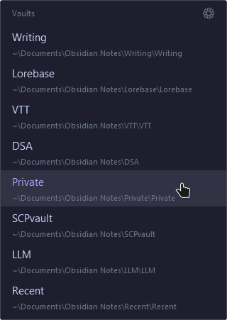

# Obsidian Vault Launcher

A minimal, lightweight launcher for your [Obsidian](https://obsidian.md) vaults. It starts instantly, lists all your vaults, and opens the one you click, nothing more.



## Features

- **One click to open:** click a vault, Obsidian opens it, the launcher closes.
- **Fast and light:** a single Python file using only the standard library (tkinter). No dependencies, no installation.
- **Automatic vault discovery:** reads Obsidian's own vault list, most recently used first.
- **Flexible sources:** add individual vault folders, or let it scan folders for vaults.
- **Minimal, borderless UI:** no window chrome; drag it by its header.
- **Keyboard friendly:** arrow keys and `Enter`, type to filter, `Esc` to close.
- **Theming with a built-in color picker:** dark and light presets, live preview, saved to your config.
- **Shows where a vault lives:** a subtle path line under each name (can be turned off).

## Requirements

- Python 3.8+ with tkinter (included in the standard Windows and macOS installers; on Debian/Ubuntu: `sudo apt install python3-tk`)
- [Obsidian](https://obsidian.md) installed (the launcher opens vaults through the `obsidian://` URI)

Developed primarily with Windows in mind. macOS and Linux should work but are less tested.

## Usage

1. Download `vault_launcher.pyw`.
2. Double-click it (on Windows, `.pyw` starts without a console window), or run:

   ```bash
   python vault_launcher.pyw
   ```

On first start, a `config.json` is created next to the script. To use a different config file:

```bash
python vault_launcher.pyw --config /path/to/config.json
```

### Controls

| Action | Result |
| --- | --- |
| Click a vault | Open it in Obsidian |
| `↑` / `↓`, `Enter` | Select and open |
| Type | Filter the list |
| `F2` or the ⚙ icon | Open the color settings |
| `Esc` | Back / close |
| Drag the header | Move the window |

### Quick access

- **Hotkey (Windows):** right-click the file → *Create shortcut* → in the shortcut's properties, set a shortcut key (e.g. `Ctrl+Alt+O`).
- **Standalone `.exe`:**

  ```bash
  pip install pyinstaller
  pyinstaller --onefile --noconsole vault_launcher.pyw
  ```

  Keep `config.json` next to the resulting `.exe`.

## Colors and theming

Press `F2` (or click ⚙) to open the color settings. Click a color swatch to open the system color picker; changes are previewed live. **Save** writes only the colors that differ from the selected preset to `config.json`. Without saving, changes apply to the current session only.

## Configuration

All options live in `config.json`:

| Key | Default | Description |
| --- | --- | --- |
| `auto_discover` | `true` | Use the vault list from Obsidian's `obsidian.json` |
| `vault_locations` | `[]` | List of individual vault folders |
| `scan_folders` | `[]` | Folders to scan for vaults (subfolders containing `.obsidian`) |
| `scan_depth` | `2` | How deep to scan inside `scan_folders` |
| `exclude` | `[]` | Vault names or paths to hide |
| `aliases` | `{}` | Custom display names, e.g. `{"C:/Notes/Work": "Work"}` |
| `sort` | `"recent"` | `"recent"` (last opened first) or `"name"` |
| `close_after_launch` | `true` | Close the launcher after opening a vault |
| `window.width` | `320` | Window width in pixels |
| `window.row_height` | `36` | Row height |
| `window.max_visible` | `10` | Rows visible before scrolling |
| `window.show_title` | `true` | Show the header text |
| `window.title` | `"Vaults"` | Header text |
| `window.show_path` | `true` | Show the folder path under each name |
| `theme.preset` | `"dark"` | `"dark"` or `"light"` |
| `theme.font` | `"Segoe UI"` | Font family |
| `theme.font_size` | `11` | Font size |
| `theme.bg`, `fg`, `dim`, `hover`, `accent`, `border` | from preset | Override individual colors, e.g. `"accent": "#ff8800"` |

Example:

```json
{
  "scan_folders": ["~/Documents/Notes"],
  "exclude": ["Scratch"],
  "sort": "name",
  "theme": { "preset": "dark", "accent": "#ff8800" }
}
```

Vault paths and `scan_folders` support `~` for your home directory.

## Troubleshooting

- **An unexpected vault appears in the list:** check the path line under its name. It is either registered in Obsidian (remove it via *Manage vaults*), found through `scan_folders`, or listed in `vault_locations`. You can also hide it via `exclude`.
- **No vaults found:** make sure Obsidian has been run at least once, or add folders via `vault_locations` / `scan_folders`.

## Credits

This project, including this README, was written by [Claude](https://claude.ai) (Anthropic) based on the author's requirements.
